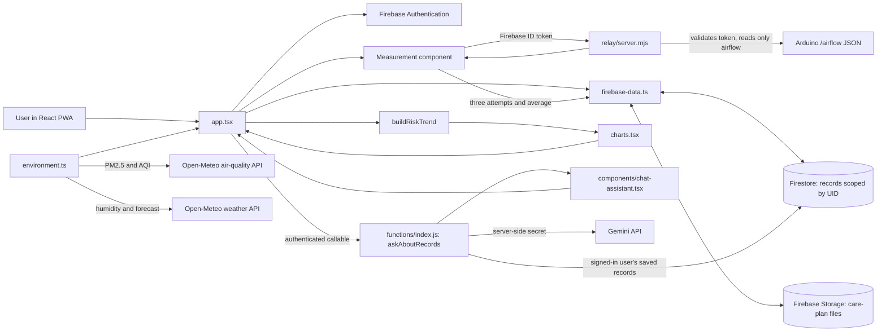

# Code and data workflow

## System view

## Main flows

### Sign-in and saved records

1. `auth-flow.tsx` handles sign-in, account creation, Google sign-in, and password reset.
2. `app.tsx` observes Firebase Auth state.
3. `firebase-data.ts` creates missing profile/settings documents and subscribes to the signed-in user's records.
4. Records live under `users/{uid}`. `firestore.rules` allows a user to read and write only their own documents; care-plan files use Firebase Storage rules.

### Live airflow measurement

1. The Measure view requests a Firebase ID token and polls the configured relay endpoint.
2. `relay/server.mjs` verifies the Firebase token, fetches `/airflow` from the Arduino, and checks that pressure, velocity, and estimated flow are numeric.
3. The interface counts down, captures three test results, calculates their average, and saves the result through `firebase-data.ts` when the user confirms.
4. The saved record retains its timestamp and units. The hardware flow estimate should not be described as a clinical lung-function test.

### Environment and risk trend

`environment.ts` fetches hourly air-quality values (PM2.5 and US AQI) and humidity/weather from Open-Meteo. `buildRiskTrend` combines regional conditions with available breathing readings and symptom/activity logs. It requires at least 14 symptom-log days to fit a personal trend; with less history it returns no personal forecast. When it has enough history, the code fits a recency-weighted, regularized model and produces an hourly trend for the next 24 hours. Gemini does not generate this chart. The model has not been clinically validated.

### Account-aware chat

`components/chat-assistant.tsx` collects the question. `app.tsx` calls the Firebase callable function `askAboutRecords`. `functions/index.js` checks authentication, reads a limited set of the caller's own records, and calls Gemini using a server-side Secret Manager key. If the model is unavailable, the function returns a simple saved-record summary. Chat answers must not diagnose or recommend medication changes.

### Community map

The map uses real map geography. The plotted zones, report counts, and markers are configured in the app for demonstration and are not collected community submissions. Present them as an illustration of the interface, not as measured neighborhood data.

## Source tour

| File | Role |
| --- | --- |
| `app.tsx` | Main pages, navigation, measurement UI, state coordination, and the connection between features |
| `auth-flow.tsx` | Sign-in and account flows |
| `firebase.ts` | Firebase client setup and callable-function helpers |
| `firebase-data.ts` | Account-scoped Firestore and Storage operations |
| `environment.ts` | Open-Meteo requests, data shaping, and risk-trend model |
| `charts.tsx` | Risk, breathing, symptom, and environmental charts |
| `components/chat-assistant.tsx` | Floating chat window and message UI |
| `functions/index.js` | Server-side account-aware Gemini chat and notification functions |
| `relay/server.mjs` | Firebase-token-protected read-only bridge to the Arduino |
| `firestore.rules`, `storage.rules` | Per-account database and file access rules |
| `build.mjs`, `style.css` | Production bundle generation and visual styling |
